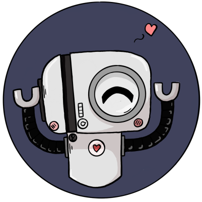

  

A single-server Discord bot based on *The Amazing World of Gumball*, built with Hikari and Hikari-Lightbulb for moderation and confessions.

 - Created April 26, 2021
 - Written in Python using [`hikari`](https://github.com/hikari-py/hikari) and [`hikari-lightbulb`](https://github.com/tandemdude/hikari-lightbulb)
 
## Description

Bobert is a personal Discord bot originally created for moderation and confessions. It was later migrated from disnake to Hikari and expanded with additional features.
